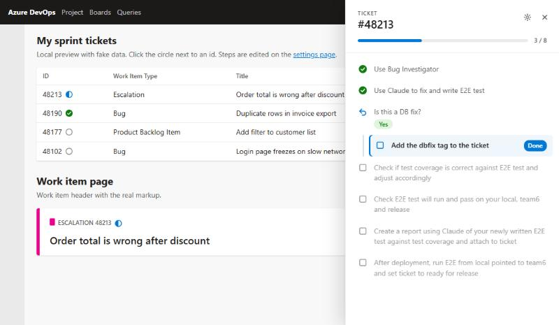

# Stepper

A small Chrome and Edge extension that keeps a release checklist for every Azure DevOps ticket,
right next to the ticket id. Tick steps as you go, undo the last one if you clicked too early,
and see at a glance which tickets still have work left before release.



## Features

- **Status at a glance.** An icon next to each ticket id in query results and on the work item page:
  empty circle (not started), half-filled circle (in progress), green check (all steps done).
- **Steps panel.** Click the icon to open the ticket's steps on the right. Click the current step's row to
  mark it done; click the most recent done step to undo it. Steps are done in order.
- **Conditional steps.** A step can be a yes/no question, such as "Is this a DB fix?". Only the steps under
  the chosen answer are added to that ticket. Questions can be nested.
- **Your own checklist.** Steps and questions are defined once on the settings page and apply to every ticket. Export and import them as a JSON file.
- **Local only.** Everything lives in the browser's extension storage, keyed by ticket id.
  No server, no Azure DevOps token, nothing leaves the browser.
- **Works with self-hosted Azure DevOps.** The extension runs only on the address you allow in settings.

## Install

**[Download the latest zip](https://github.com/ouzzm/stepper/releases/latest)** (the `stepper-<version>.zip` file under Assets),
then follow [INSTALL.md](INSTALL.md) (also included in the zip as `README.md`).

In short:

1. Download `stepper-<version>.zip` from the [latest release](https://github.com/ouzzm/stepper/releases/latest) and unzip it into a folder you will keep.
2. Open `chrome://extensions` or `edge://extensions` and turn on **Developer mode**.
3. Click **Load unpacked** and pick the unzipped folder.
4. Click the Stepper toolbar button, enter your Azure DevOps address, click **Allow**, then reload Azure DevOps tabs.

## Development

Requires Node.js 24 or newer (the tests run TypeScript directly through Node's type stripping).

```bash
npm install
npm run build      # builds the extension into dist/
```

| Script | What it does |
| --- | --- |
| `npm run build` | Bundles the extension into `dist/` (load this folder unpacked) |
| `npm run watch` | Rebuilds `dist/` on every change |
| `npm run preview` | Serves http://localhost:5173 with a fake Azure DevOps page and the settings page |
| `npm test` | Runs the unit tests (Node's built-in test runner) |
| `npm run typecheck` | Type-checks the whole project |
| `npm run package` | Builds and zips `dist/` with the install guide into `release/stepper-<version>.zip` |

After a rebuild, click the reload button on the Stepper card in the extensions page and reload Azure DevOps tabs.

### Releasing

1. Bump `version` in `src/manifest.json` and `package.json` (same value) and commit.
2. Tag and push:

   ```bash
   git tag v1.0.1
   git push origin master v1.0.1
   ```

The [Release workflow](.github/workflows/release.yml) checks that the tag matches both versions, runs the
type check and tests, builds the zip and publishes it as a GitHub release.

### Local preview

`npm run preview` runs the real panel and icon code on a fake page that copies the Azure DevOps markup
the extension reads. `src/preview/chromeShim.ts` stands in for the `chrome.*` APIs and keeps data in the
page's localStorage. The preview is never part of the extension build.

## How it works

- **Content script** (`src/content`): watches the page with a `MutationObserver`, because Azure DevOps renders
  lazily, recycles grid rows and navigates without reloads. Page adapters find ticket ids:
  - Query results: id cells of the bolt table (`td.bolt-table-cell`) in the column whose header is "ID".
  - Work item: the header link `/_workitems/edit/<id>` next to the work item type icon.
  Icons and the panel live in shadow roots so Azure DevOps styles do not leak in.
- **Step engine** (`src/core/engine.ts`): pure functions that flatten the step tree by the chosen answers and
  compute each step's state. Progress is an ordered stack of done step ids plus the answers to questions.
- **Background** (`src/background.ts`): registers the content script only on the hosts allowed in settings.
- **Settings** (`src/options`): allowed hosts, the step editor, and step export and import.

## Project structure

```
src/
  core/        step model, step engine, template validation, storage helpers
  content/     status icons, steps panel, page adapters
  options/     settings page
  preview/     chrome.* stand-in for the local preview
  background.ts
  manifest.json
test/          unit tests
preview/       fake Azure DevOps page for the local preview
```

## Notes

- If Azure DevOps changes its markup and the icons stop appearing, the selectors to update are in
  `src/content/adapters/queryResults.ts` and `src/content/adapters/workItem.ts`.
- Data is per browser: Chrome and Edge keep separate steps and progress.
